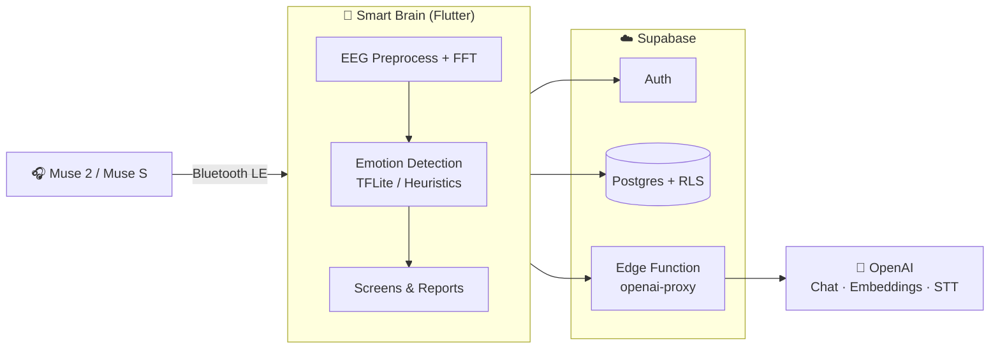

<div align="center">

กหดก
# 🧠 Smart Brain
กหกฟ
**BRAIN-AI — Brainwave Recognition & Analysis using Intelligent AI**

แอป Flutter สำหรับวัดคลื่นสมองด้วย Muse (Muse 2 / Muse S)<br/>
ประเมินสุขภาพจิต (PHQ-9) และให้คำแนะนำด้วย AI


[ฟีเจอร์](#-ฟีเจอร์) •
[สถาปัตยกรรม](#-สถาปัตยกรรม) •
[เริ่มต้นใช้งาน](#-รันในเครื่อง) •
[OpenAI Proxy](#-openai-ผ่าน-supabase-edge-function) •
[Deploy เว็บ](#-deploy-เว็บ) •ดกหำดห
[Muse บนเว็บ](#-การเชื่อมต่อ-muse-บนเว็บ)กหกห

</div>ำหดำดหด
---

## ✨ ฟีเจอร์

| | ฟีเจอร์ | รายละเอียด |
|:-:|---|---|
| 🎧 | **วัดคลื่นสมอง (EEG)** | เชื่อมต่อ Muse 2 / Muse S ผ่าน Bluetooth แสดงคลื่นสมองแบบเรียลไทม์ พร้อม FFT และแผนที่ศีรษะ |
| 😊 | **ตรวจจับอารมณ์** | โมเดล TSception (TFLite) ทำงานบนเครื่อง ส่วนบนเว็บใช้สูตรจากสัดส่วนคลื่นสมอง |
| 📝 | **แบบประเมิน PHQ-9** | ประเมินภาวะซึมเศร้า และเก็บประวัติผลการประเมิน |
| 🤖 | **ผู้ช่วย AI** | แชตพร้อม RAG, ถอดเสียง (STT) และอ่านออกเสียง (TTS) |
| 📊 | **รายงาน** | รายงานผลการประเมิน EEG, รายงานประจำสัปดาห์ และส่งออกเป็น PDF |
| 🌿 | **สุขภาวะ** | คำแนะนำเฉพาะบุคคล และข้อมูลโภชนาการ |
| 🎮 | **มินิเกม** | เกมจับคู่ความจำ และเกมเรียงตัวเลข |
| 🔐 | **บัญชีผู้ใช้** | สมัครและล็อกอินด้วยอีเมลกับรหัสผ่าน ผ่าน Supabase Auth |

## 🏗 สถาปัตยกรรม



### เทคโนโลยีที่ใช้

| ส่วน | เทคโนโลยี |
|---|---|
| แอป | Flutter, Dart, `fl_chart`, `google_fonts` |
| Bluetooth | `flutter_blue_plus` (รวม Web Bluetooth) |
| โมเดล | `tflite_flutter` — TSception |
| Backend | Supabase (Auth, Postgres, Storage, Edge Functions) |
| AI | OpenAI ผ่าน `supabase/functions/openai-proxy` |
| Python | FastAPI (`emotion_api/`) สำหรับ API ตรวจจับอารมณ์ และสคริปต์เทรน/แปลงโมเดล |

### โครงสร้างโปรเจกต์

```text
├── lib/
│   ├── emotion_detection/   # ตรวจจับอารมณ์ (TFLite / heuristics)
│   ├── screens/             # หน้าจอ แยกตามฟีเจอร์
│   │   ├── auth/  home/  eeg/  assessment/
│   │   └── wellness/  games/  reports/  profile/
│   ├── services/            # muse, eeg, ai, speech, supabase
│   ├── widgets/             # วิดเจ็ตที่ใช้ร่วมกัน
│   └── theme/  utils/  models/
├── assets/models/           # โมเดล TFLite และ scaler
├── emotion_api/             # FastAPI + สคริปต์โมเดล (Python)
├── supabase/
│   ├── functions/           # Edge Function: openai-proxy
│   └── migrations/          # SQL schema และ RLS
├── tests/                   # pytest
└── env/                     # supabase.example.json
```

---

## 🚀 รันในเครื่อง

```bash
flutter pub get
cp env/supabase.example.json env/supabase.json   # ครั้งแรกครั้งเดียว แล้วใส่ URL และ anon key ของโปรเจกต์
flutter run --dart-define-from-file=env/supabase.json              # มือถือที่ต่ออยู่
flutter run -d chrome --dart-define-from-file=env/supabase.json    # เว็บ
```

> [!WARNING]
> `env/supabase.json` อยู่ใน `.gitignore` **ห้าม commit**

> [!TIP]
> ใน VS Code กด <kbd>F5</kbd> ได้เลย เพราะ `.vscode/launch.json` ส่งไฟล์นี้ให้แล้ว<br/>
> ถ้าลืมส่งไฟล์ แอปจะขึ้นข้อความ `ไม่พบ SUPABASE_URL / SUPABASE_ANON_KEY` ใน debug console

OpenAI key อยู่ฝั่ง server (ดูหัวข้อถัดไป)

## 🔑 OpenAI ผ่าน Supabase Edge Function

แชต, RAG embeddings และถอดเสียง เรียก OpenAI ผ่าน `supabase/functions/openai-proxy`
ตัว function ตรวจว่าผู้ใช้ล็อกอินแล้ว และกำหนดโมเดลกับขนาดคำขอสูงสุดไว้ฝั่ง server

```bash
supabase login
supabase link --project-ref ifsvthnxydchqnigvmuw
supabase secrets set OPENAI_API_KEY=sk-...
supabase functions deploy openai-proxy
```

> [!CAUTION]
> ถ้า key เดิมเคยอยู่ใน `.env` ที่ build เป็นแอปหรือเว็บไปแล้ว ให้ยกเลิก key นั้นที่ OpenAI แล้วสร้างใหม่

## 🌐 Deploy เว็บ

```bash
flutter build web --release --dart-define-from-file=env/supabase.json
# อัปโหลดโฟลเดอร์ build/web ขึ้น static hosting ที่มี HTTPS เช่น
npx vercel deploy build/web --prod
```

**หลัง deploy**

- [ ] เพิ่ม URL ของเว็บใน Supabase → Authentication → URL Configuration (Site URL และ Redirect URLs) เพื่อให้ลิงก์ยืนยันอีเมลและลิงก์ตั้งรหัสผ่านใหม่พากลับมาที่เว็บได้
- [ ] เปิด RLS ให้ครบทุกตาราง เพราะ anon key อยู่ในตัวเว็บ

## 📡 การเชื่อมต่อ Muse บนเว็บ

เว็บใช้ Web Bluetooth ผ่าน `flutter_blue_plus`

| เบราว์เซอร์ | ต่อ Muse ได้ |
|---|:-:|
| Chrome / Edge บน Windows, macOS, Android | ✅ |
| Safari, ทุกเบราว์เซอร์บน iPhone/iPad, Firefox | ❌ ใช้แอปมือถือแทน |

> [!NOTE]
> - ต้องเปิดผ่าน HTTPS หรือ `localhost`
> - กดปุ่มเชื่อมต่อแล้วเลือกอุปกรณ์ในหน้าต่างของเบราว์เซอร์
> - การตรวจอารมณ์บนเว็บใช้สูตรจากสัดส่วนคลื่นสมอง (`emotion_heuristics.dart`) เพราะ TFLite ใช้บนเว็บไม่ได้
> - โหมดจำลองให้ดูหน้าจอได้ แต่ไม่บันทึกผลลงประวัติ

---
กหดหดหดหดห
<div align="center">

สร้างด้วย 💙 Flutter และ Supabase

</div>
pair
