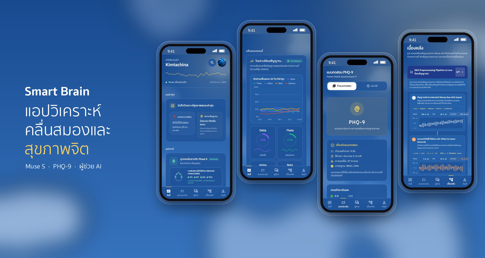
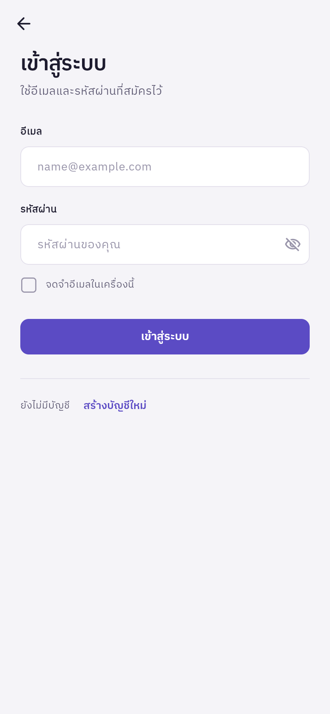

 
<b>วันนี้</b> · สถานะ Muse และผลล่าสุด &nbsp;|&nbsp; <b>คลื่นสมองตอนนี้</b> · กราฟสัดส่วนคลื่น 60 วินาที &nbsp;|&nbsp; <b>แบบประเมิน PHQ-9</b> &nbsp;|&nbsp; <b>เบื้องหลัง</b> · ขั้นตอนเตรียมสัญญาณ EEG แบบสด 
ภาพจากโหมดจำลอง (ข้อมูลสุ่ม ไม่ใช่สัญญาณจริง)

&nbsp;&nbsp;&nbsp;

ถ้ารู้สึกไม่สบายใจ โทรสายด่วนสุขภาพจิต 1323 ได้ตลอด 24 ชั่วโมง

