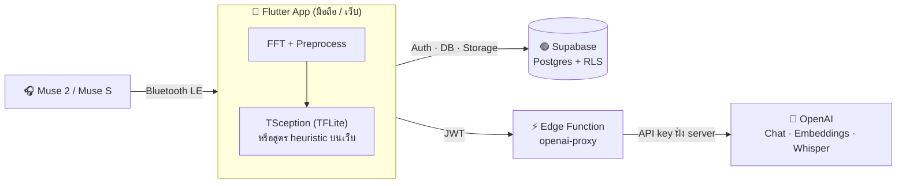

<div align="center">


# 🧠 Smart Brain

**BRAIN-AI · Brainwave Recognition & Analysis using Intelligent AI**

แอปวัดคลื่นสมองด้วยอุปกรณ์ Muse ประเมินสุขภาพจิตด้วยแบบประเมิน PHQ-9
และให้คำแนะนำส่วนตัวด้วย AI


</div>

---

## ✨ ฟีเจอร์หลัก

| | ฟีเจอร์ | รายละเอียด |
|---|---|---|
| 🎧 | **วัดคลื่นสมองแบบเรียลไทม์** | เชื่อมต่อ Muse 2 / Muse S ผ่าน Bluetooth อ่าน 4 ขั้ว (TP9, AF7, AF8, TP10) แล้วแยกย่านความถี่ Delta, Theta, Alpha, Beta, Gamma ด้วย FFT |
| 😊 | **ตรวจอารมณ์จากคลื่นสมอง** | ใช้โมเดล TSception (TFLite) บนมือถือ แยกอารมณ์ได้ 4 แบบ: Happy, Relaxed, Sad, Angry/Fear |
| 📝 | **แบบประเมิน PHQ-9** | ประเมินภาวะซึมเศร้า 9 ข้อ พร้อมแปลผลระดับความรุนแรง |
| 🤖 | **ผู้ช่วย AI** | แชตให้คำแนะนำด้วย ChatGPT + RAG จากคลังความรู้ พิมพ์หรือพูดก็ได้ (ถอดเสียง + อ่านออกเสียง) |
| 📊 | **รายงานผล** | รายงาน EEG แต่ละครั้ง ประวัติย้อนหลัง รายงานรายสัปดาห์ และ export เป็น PDF |
| 🌿 | **ดูแลสุขภาวะ** | คำแนะนำด้านโภชนาการและการผ่อนคลาย และมินิเกมฝึกสมอง (จับคู่ความจำ, Number Puzzle) |

---

## 🏗️ สถาปัตยกรรม



> 🔐 OpenAI key ไม่อยู่ในตัวแอปหรือเว็บ ทุกคำขอวิ่งผ่าน Edge Function ที่ตรวจว่าผู้ใช้ล็อกอินแล้ว และล็อกโมเดลกับขนาดคำขอไว้ฝั่ง server

---

## 🧰 เทคโนโลยีที่ใช้

| ส่วน | เทคโนโลยี |
|---|---|
| แอป | Flutter, `flutter_blue_plus`, `fl_chart`, `tflite_flutter`, `pdf` / `printing`, `flutter_tts`, `record` |
| Backend | Supabase (Auth + Google Sign-In, Postgres + RLS, Storage, Realtime), Deno Edge Function |
| AI | OpenAI Chat Completions, Embeddings (RAG), Audio Transcriptions |
| โมเดล | Python, TensorFlow / Keras, scikit-learn, FastAPI (`emotion_api/`) |

---

## 📁 โครงสร้างโปรเจกต์

```text
lib/
├── screens/            # หน้าจอแยกตามฟีเจอร์
│   ├── auth/           #   ล็อกอิน / สมัครสมาชิก
│   ├── home/           #   หน้าหลัก + บันทึกคลื่นสมอง
│   ├── eeg/            #   session, รายงาน, ประวัติ EEG
│   ├── assessment/     #   แบบประเมิน PHQ-9
│   ├── wellness/       #   คำแนะนำ + โภชนาการ
│   ├── reports/        #   รายงานรายสัปดาห์
│   ├── games/          #   มินิเกม
│   └── profile/        #   โปรไฟล์และการตั้งค่า
├── services/
│   ├── muse/           # เชื่อมต่อ Muse ผ่าน BLE
│   ├── eeg/            # FFT, preprocess, ประเมินผล, สร้าง PDF
│   ├── ai/             # ChatGPT, RAG, proxy
│   └── speech/         # ถอดเสียง / อ่านออกเสียง
├── emotion_detection/  # โมเดลตรวจอารมณ์ (TFLite บนมือถือ, heuristic บนเว็บ)
└── widgets/ theme/ models/ utils/

assets/models/          # ไฟล์ .tflite + label + scaler
emotion_api/            # Python: เทรน / แปลงโมเดล + FastAPI server
supabase/
├── migrations/         # schema ของฐานข้อมูล
└── functions/          # openai-proxy + tests
tests/                  # pytest สำหรับโค้ด Python
```

---

## 🚀 เริ่มต้นใช้งาน

### สิ่งที่ต้องมี

- Flutter SDK (Dart 3.10 ขึ้นไป)
- โปรเจกต์ Supabase และ [Supabase CLI](https://supabase.com/docs/guides/cli)
- อุปกรณ์ Muse 2 หรือ Muse S (ถ้าไม่มี ใช้โหมดจำลองดูหน้าจอได้)

### 1. ตั้งค่า Supabase

```bash
cp env/supabase.example.json env/supabase.json
```

แล้วใส่ `SUPABASE_URL` และ `SUPABASE_ANON_KEY` ของโปรเจกต์ลงในไฟล์

> ⚠️ `env/supabase.json` อยู่ใน `.gitignore` ห้าม commit

### 2. รันแอป

```bash
flutter pub get
flutter run --dart-define-from-file=env/supabase.json              # มือถือที่ต่ออยู่
flutter run -d chrome --dart-define-from-file=env/supabase.json    # เว็บ
```

💡 ใน VS Code กด <kbd>F5</kbd> ได้เลย เพราะ `.vscode/launch.json` ส่งไฟล์นี้ให้แล้ว
ถ้าลืมส่งไฟล์ แอปจะขึ้นข้อความ `ไม่พบ SUPABASE_URL / SUPABASE_ANON_KEY` ใน debug console

### 3. Deploy OpenAI proxy (Edge Function)

แชต, RAG embeddings และถอดเสียง เรียก OpenAI ผ่าน `supabase/functions/openai-proxy`

```bash
supabase login
supabase link --project-ref ifsvthnxydchqnigvmuw
supabase secrets set OPENAI_API_KEY=sk-...
supabase functions deploy openai-proxy
```

> 🔑 ถ้า key เดิมเคยอยู่ใน `.env` ที่ build เป็นแอปหรือเว็บไปแล้ว ให้ยกเลิก key นั้นที่ OpenAI แล้วสร้างใหม่

---

## 🌐 Deploy เว็บ

```bash
flutter build web --release --dart-define-from-file=env/supabase.json
# อัปโหลดโฟลเดอร์ build/web ขึ้น static hosting ที่มี HTTPS เช่น
npx vercel deploy build/web --prod
```

**หลัง deploy**

- [ ] เพิ่ม URL ของเว็บใน Supabase → Authentication → URL Configuration (Site URL และ Redirect URLs) เพื่อให้ล็อกอินด้วย Google บนเว็บได้
- [ ] ตรวจว่าเปิด RLS ครบทุกตาราง เพราะ anon key อยู่ในตัวเว็บ

### 🎧 การเชื่อมต่อ Muse บนเว็บ

เว็บใช้ Web Bluetooth ผ่าน `flutter_blue_plus`

| เบราว์เซอร์ | ต่อ Muse ได้ |
|---|:---:|
| Chrome / Edge บน Windows, macOS, Android | ✅ |
| Safari, ทุกเบราว์เซอร์บน iPhone/iPad, Firefox | ❌ ใช้แอปมือถือแทน |

- ต้องเปิดผ่าน HTTPS หรือ `localhost`
- กดปุ่มเชื่อมต่อแล้วเลือกอุปกรณ์ในหน้าต่างของเบราว์เซอร์
- บนเว็บ การตรวจอารมณ์ใช้สูตรจากสัดส่วนคลื่นสมอง (`emotion_heuristics.dart`) เพราะ TFLite ใช้บนเว็บไม่ได้
- โหมดจำลองให้ดูหน้าจอได้ แต่ไม่บันทึกผลลงประวัติ

---

## 🧪 การทดสอบ

```bash
# โค้ด Python ใน emotion_api/ (ไม่ต้องติดตั้ง tensorflow)
python3 -m venv .venv
.venv/bin/pip install -r requirements-dev.txt
.venv/bin/pytest --cov --cov-report=xml

# Edge Function openai-proxy (จำลอง OpenAI ทั้งหมด ไม่เรียกเน็ตจริง)
bun test supabase/functions
```

---

## ⚕️ ข้อควรทราบ

Smart Brain เป็นเครื่องมือช่วยติดตามสุขภาวะ ไม่ใช่เครื่องมือวินิจฉัยทางการแพทย์
ถ้ารู้สึกเครียดหรือซึมเศร้ารุนแรง โปรดปรึกษาแพทย์หรือโทรสายด่วนสุขภาพจิต **1323**
