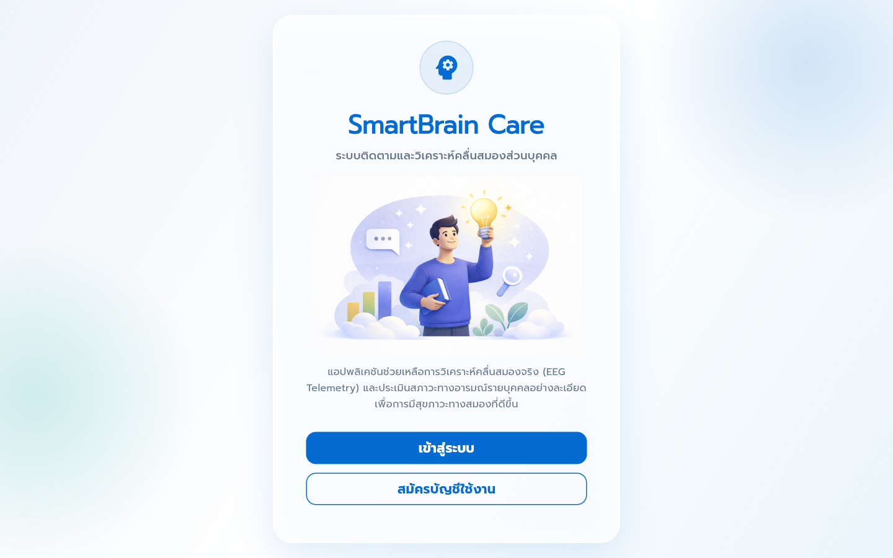
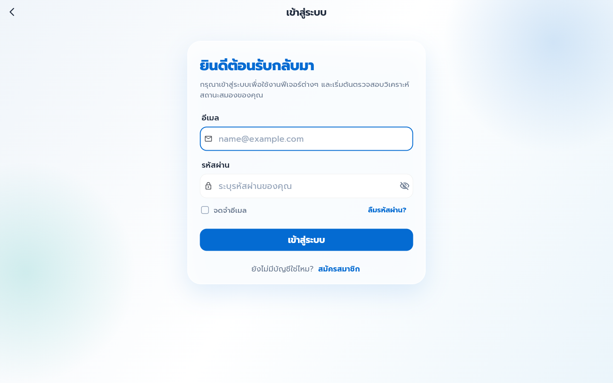
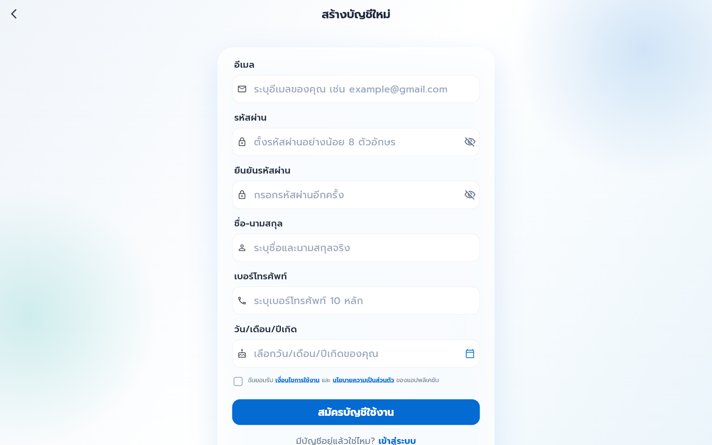
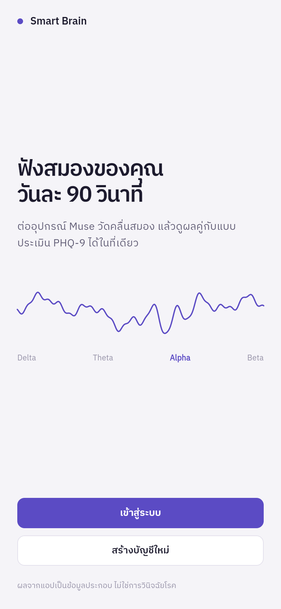
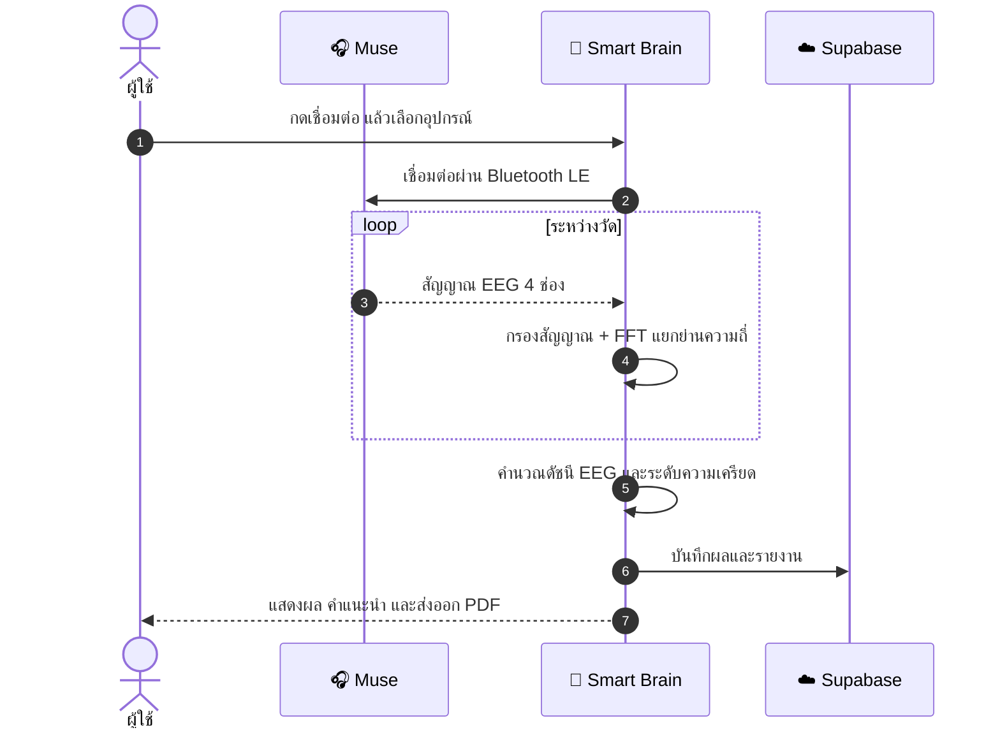
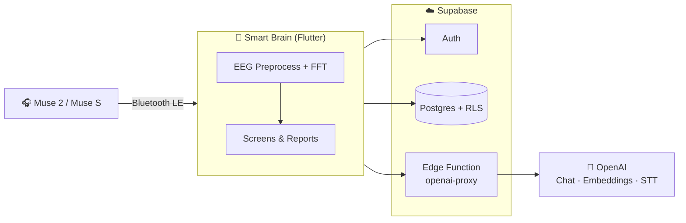

<div align="center">


# 🧠 Smart Brain

### BRAIN-AI — Brainwave Recognition & Analysis using Intelligent AI

แอป Flutter วัดคลื่นสมองด้วย Muse 2 / Muse S<br/>
ประเมินสุขภาพจิตด้วย PHQ-9 และให้คำแนะนำด้วย AI

<br/>
หแกดกห


<br/>

**[ภาพตัวอย่าง](#-ภาพตัวอย่าง)** · **[ฟีเจอร์](#-ฟีเจอร์)** · **[การทำงาน](#-การทำงาน)** · **[เริ่มต้นใช้งาน](#-เริ่มต้นใช้งาน)** · **[ทดสอบ](#-ทดสอบ)** · **[Deploy](#-deploy-เว็บ)** · **[Muse บนเว็บ](#-muse-บนเว็บ)**

</div>

<br/>

> [!IMPORTANT]
> ผลจากแอปเป็นข้อมูลประกอบ **ไม่ใช่การวินิจฉัยโรค** ควรประเมินร่วมกับแพทย์หรือนักจิตวิทยา
> ถ้าต้องการความช่วยเหลือเร่งด่วน โทร **สายด่วนสุขภาพจิต 1323** (24 ชม.)

## 📸 ภาพตัวอย่าง

### 💻 บนเว็บ

<table>
<tr>
<td colspan="2" align="center">
<br/>
<sub><b>หน้าแรก</b></sub>
</td>
</tr>
<tr>
<td width="50%" align="center">
<br/>
<sub><b>เข้าสู่ระบบ</b> · ด้วยอีเมลและรหัสผ่าน</sub>
</td>
<td width="50%" align="center">
<br/>
<sub><b>สร้างบัญชีใหม่</b> · สมัครด้วยอีเมลและรหัสผ่าน</sub>
</td>
</tr>
</table>

### 📱 บนมือถือ

<p align="center">

&nbsp;&nbsp;&nbsp;

</p>

## ✨ ฟีเจอร์

<table>
<tr>
<td width="50%" valign="top">

#### 🎧 วัดคลื่นสมอง (EEG)
เชื่อมต่อ Muse 2 / Muse S ผ่าน Bluetooth แสดงคลื่นสมองแบบเรียลไทม์ พร้อม FFT และแผนที่ศีรษะ

</td>
<td width="50%" valign="top">

#### 📝 แบบประเมิน PHQ-9
ประเมินภาวะซึมเศร้า และเก็บประวัติผลการประเมินไว้ดูย้อนหลัง

</td>
</tr>
<tr>
<td width="50%" valign="top">

#### 🤖 ผู้ช่วย AI
แชตพร้อม RAG ถอดเสียงพูด (STT) และอ่านออกเสียง (TTS)

</td>
<td width="50%" valign="top">

#### 📊 รายงาน
รายงานผล EEG รายงานประจำสัปดาห์ และส่งออกเป็น PDF

</td>
</tr>
<tr>
<td width="50%" valign="top">

#### 🌿 สุขภาวะ
คำแนะนำเฉพาะบุคคล และข้อมูลโภชนาการ

</td>
<td width="50%" valign="top">

#### 🎮 มินิเกม
เกมจับคู่ความจำ และเกมเรียงตัวเลข

</td>
</tr>
<tr>
<td colspan="2" valign="top">

#### 🔐 บัญชีผู้ใช้
สมัครและล็อกอินด้วยอีเมลกับรหัสผ่าน ผ่าน Supabase Auth

</td>
</tr>
</table>

## 🔄 การทำงาน

### หนึ่งรอบการวัด



### สถาปัตยกรรม



### เทคโนโลยีที่ใช้

| ส่วน | เทคโนโลยี |
|---|---|
| 📱 แอป | Flutter, Dart, `fl_chart`, `google_fonts` |
| 📡 Bluetooth | `flutter_blue_plus` (รองรับ Web Bluetooth) |
| ☁️ Backend | Supabase (Auth, Postgres, Storage, Edge Functions) |
| 🤖 AI | OpenAI ผ่าน `supabase/functions/openai-proxy` |

<details>
<summary><b>📁 โครงสร้างโปรเจกต์</b></summary>

<br/>

```text
├── lib/
│   ├── screens/             # หน้าจอ แยกตามฟีเจอร์
│   │   ├── auth/  home/  eeg/  assessment/
│   │   └── wellness/  games/  reports/  profile/
│   ├── services/            # muse, eeg, ai, speech, supabase
│   ├── widgets/             # วิดเจ็ตที่ใช้ร่วมกัน
│   └── theme/  utils/  models/
├── assets/images/           # รูปภาพในแอป
├── docs/screenshots/        # ภาพหน้าจอที่ใช้ใน README
├── supabase/
│   ├── functions/           # Edge Function: openai-proxy
│   └── migrations/          # SQL schema และ RLS
├── test/                    # Flutter widget tests
└── env/                     # supabase.example.json
```

</details>

---

## 🚀 เริ่มต้นใช้งาน

### สิ่งที่ต้องมี

| | เวอร์ชัน |
|---|---|
| Flutter SDK | รุ่นที่มี Dart 3.10 ขึ้นไป |
| โปรเจกต์ Supabase | URL และ anon key |
| Muse 2 / Muse S | ไม่บังคับ มีโหมดจำลองให้ดูหน้าจอได้ |

### รันในเครื่อง

```bash
# 1. ติดตั้งแพ็กเกจ
flutter pub get

# 2. ตั้งค่า Supabase (ครั้งแรกครั้งเดียว) แล้วใส่ URL และ anon key ของโปรเจกต์
cp env/supabase.example.json env/supabase.json

# 3. รัน
flutter run --dart-define-from-file=env/supabase.json              # มือถือที่ต่ออยู่
flutter run -d chrome --dart-define-from-file=env/supabase.json    # เว็บ
```

> [!WARNING]
> `env/supabase.json` อยู่ใน `.gitignore` **ห้าม commit**

> [!TIP]
> ใน VS Code กด <kbd>F5</kbd> ได้เลย เพราะ `.vscode/launch.json` ส่งไฟล์นี้ให้แล้ว<br/>
> ถ้าลืมส่งไฟล์ แอปจะขึ้นข้อความ `ไม่พบ SUPABASE_URL / SUPABASE_ANON_KEY` ใน debug console

### 🔑 OpenAI ผ่าน Supabase Edge Function

แชต, RAG embeddings และถอดเสียง เรียก OpenAI ผ่าน `supabase/functions/openai-proxy`
ตัว function ตรวจว่าผู้ใช้ล็อกอินแล้ว และกำหนดโมเดลกับขนาดคำขอสูงสุดไว้ฝั่ง server จึงไม่มี OpenAI key อยู่ในแอป

```bash
supabase login
supabase link --project-ref ifsvthnxydchqnigvmuw
supabase secrets set OPENAI_API_KEY=sk-...
supabase functions deploy openai-proxy
```

> [!CAUTION]
> ถ้า key เดิมเคยอยู่ใน `.env` ที่ build เป็นแอปหรือเว็บไปแล้ว ให้ยกเลิก key นั้นที่ OpenAI แล้วสร้างใหม่

## 🧪 ทดสอบ

```bash
flutter analyze
flutter test
```

## 🌐 Deploy เว็บ

```bash
flutter build web --release --dart-define-from-file=env/supabase.json
# อัปโหลดโฟลเดอร์ build/web ขึ้น static hosting ที่มี HTTPS เช่น
npx vercel deploy build/web --prod
```

**เช็กลิสต์หลัง deploy**

- [ ] เพิ่ม URL ของเว็บใน Supabase → Authentication → URL Configuration (Site URL และ Redirect URLs) เพื่อให้ลิงก์ยืนยันอีเมลพากลับมาที่เว็บได้
- [ ] เปิด RLS ให้ครบทุกตาราง เพราะ anon key อยู่ในตัวเว็บ

## 📡 Muse บนเว็บ

เว็บเชื่อมต่อ Muse ด้วย Web Bluetooth ผ่าน `flutter_blue_plus`

| เบราว์เซอร์ | ต่อ Muse ได้ |
|---|:-:|
| Chrome / Edge บน Windows, macOS, Android | ✅ |
| Safari, ทุกเบราว์เซอร์บน iPhone/iPad, Firefox | ❌ ใช้แอปมือถือแทน |

> [!NOTE]
> - ต้องเปิดผ่าน HTTPS หรือ `localhost`
> - กดปุ่มเชื่อมต่อแล้วเลือกอุปกรณ์ในหน้าต่างของเบราว์เซอร์
> - โหมดจำลองให้ดูหน้าจอได้ แต่ไม่บันทึกผลลงประวัติ

---

<div align="center">

สร้างด้วย 💙 Flutter และ Supabase

<sub>ถ้ารู้สึกไม่สบายใจ โทรสายด่วนสุขภาพจิต 1323 ได้ตลอด 24 ชั่วโมง</sub>

</div>
